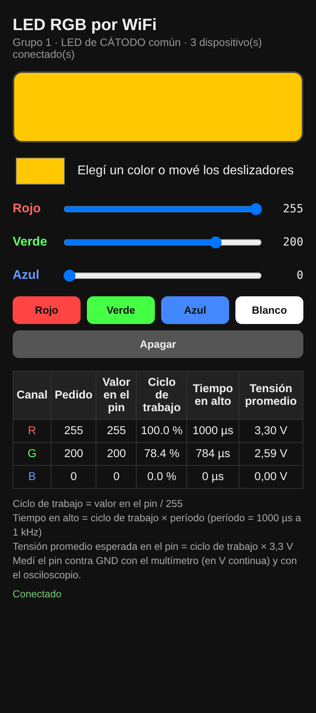

# Clase 1 – ESP8266: PWM y ADC con LED RGB

Cada grupo usa los dos periféricos básicos del ESP8266: el **PWM**, para dar valores intermedios con un pin que solo tiene dos niveles, y el **ADC**, para medir una tensión con la entrada A0. Controlan un LED RGB desde el celular, a través de una red WiFi propia de la placa, y comprueban con osciloscopio y multímetro que los valores del programa son los que realmente hay en los pines.

## Contenido

| Archivo | Para qué sirve |
| --- | --- |
| [`firmware/clase01_led_wifi/`](firmware/clase01_led_wifi/clase01_led_wifi.ino) | Programa de la clase. Crea la red `ROBOTICA-G1` a `ROBOTICA-G5` y sirve la página en `192.168.4.1` |
| [`firmware/s1_pwm_frecuencia/`](firmware/s1_pwm_frecuencia/s1_pwm_frecuencia.ino) | Simulador 1: PWM con valor y frecuencia por Monitor serie o potenciómetro; PWM a mano por debajo de 100 Hz |
| [`firmware/s2_mezcla_rgb/`](firmware/s2_mezcla_rgb/s2_mezcla_rgb.ino) | Simulador 2: mezcla de colores por Monitor serie (`255,140,0` o `#FF8C00`) y arcoíris |
| [`firmware/s3_anodo_comun/`](firmware/s3_anodo_comun/s3_anodo_comun.ino) | Simulador 3: secuencia de colores para el desafío del ánodo común |
| [`firmware/s4_medidor_led/`](firmware/s4_medidor_led/s4_medidor_led.ino) | Simulador 4: mide la tensión del LED en A0 y calcula la corriente |
| [`firmware/t0_parpadeo/`](firmware/t0_parpadeo/t0_parpadeo.ino) | Programa de prueba del tutorial: comprueba IDE, driver y placa |
| [`guia/guia-docente.md`](guia/guia-docente.md) | Guía para el docente: materiales, conexionado, desarrollo en 90 minutos, mediciones, desafío, tres niveles y ficha del alumno |
| [`simuladores/index.html`](simuladores/index.html) | Simuladores con esquemas de conexionado estilo protoboard y el código de cada ejemplo |
| [`simuladores/tutorial.html`](simuladores/tutorial.html) | Tutorial: configurar el IDE para el ESP8266 y volver al driver CH340 de 2019 |

Todos los programas compilan sin errores ni advertencias para **NodeMCU 1.0 (ESP-12E Module)** con el núcleo esp8266 3.1.2.

**Simuladores en línea:** https://dihubar-educations.github.io/robotica-iot/clases/01-pwm-adc-led-rgb/simuladores/

**Tutorial del IDE y el driver CH340:** https://dihubar-educations.github.io/robotica-iot/clases/01-pwm-adc-led-rgb/simuladores/tutorial.html

## Datos rápidos

- **Placa:** NodeMCU 1.0 (ESP-12E Module).
- **Pines:** rojo D5, verde D6, azul D7.
- **Red:** `ROBOTICA-G` + número de grupo, clave `robotica2026`.
- **PWM:** 0 a 255, 1 kHz.
- **Antes de cargar:** cambiar `GRUPO` (1 a 5) y `ANODO_COMUN` según el LED.

## Uso de memoria (compilado con esp8266 3.1.2)

| Memoria | Usado | Disponible |
| --- | --- | --- |
| Flash | 284 KB (27 %) | 1024 KB |
| RAM | 29 KB (36 %) | 80 KB |
| IRAM | 61,3 KB (93 %) | 64 KB |
