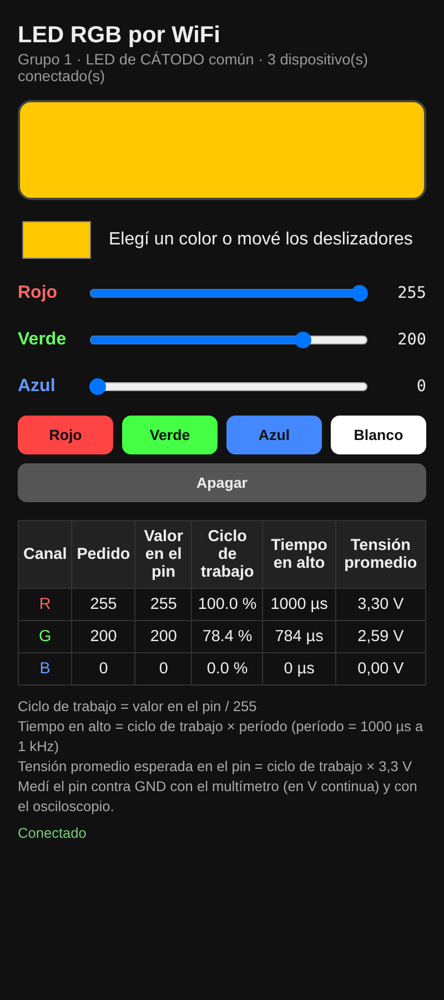

# Clase 1 – La placa que crea su propia red

Cada grupo convierte su NodeMCU en una red WiFi propia, con una página web interna, y controla un LED RGB desde el celular. Después comprueba con osciloscopio y multímetro que los valores que muestra la página son los que realmente salen por el pin.

## Contenido

| Archivo | Para qué sirve |
| --- | --- |
| [`firmware/clase01_led_wifi/clase01_led_wifi.ino`](firmware/clase01_led_wifi/clase01_led_wifi.ino) | Programa para el NodeMCU V3. Crea la red `ROBOTICA-G1` a `ROBOTICA-G5` y sirve la página en `192.168.4.1` |
| [`guia/guia-docente.md`](guia/guia-docente.md) | Guía para el docente: materiales, conexionado, desarrollo en 90 minutos, mediciones, desafío, tres niveles y ficha del alumno |
| [`simuladores/index.html`](simuladores/index.html) | Simuladores para proyectar: PWM con osciloscopio y multímetro, mezcla RGB, ánodo común, recorrido del pedido y cálculo de resistencias |

**Simuladores en línea:** https://dihubar-educations.github.io/robotica-iot/clases/01-red-propia-led-rgb/simuladores/

## Datos rápidos

- **Placa:** NodeMCU 1.0 (ESP-12E Module).
- **Pines:** rojo D5, verde D6, azul D7.
- **Red:** `ROBOTICA-G` + número de grupo, clave `robotica2026`.
- **PWM:** 0 a 255, 1 kHz.
- **Antes de cargar:** cambiar `GRUPO` (1 a 5) y `ANODO_COMUN` según el LED.

## Uso de memoria (compilado con esp8266 3.1.2)

| Memoria | Usado | Disponible |
| --- | --- | --- |
| Flash | 284 KB (27 %) | 1024 KB |
| RAM | 29 KB (36 %) | 80 KB |
| IRAM | 61,3 KB (93 %) | 64 KB |
