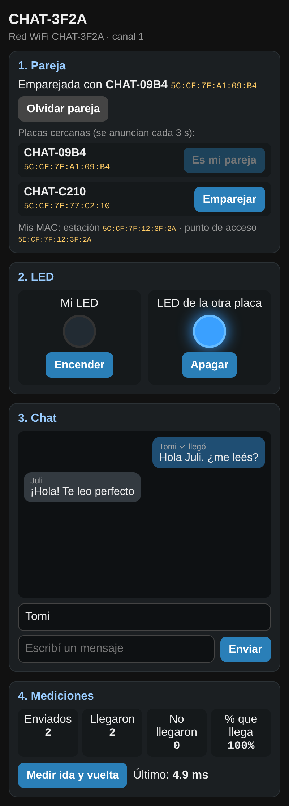

# Clase 2 – ESP8266: ESP-NOW, chat y LED remoto

Dos placas NodeMCU se comunican directamente por **ESP-NOW**, sin router ni internet, mientras cada una atiende a un celular con su propia red WiFi y una página web. Desde el celular se chatea con el otro celular y se prende o apaga el LED de la placa propia o de la placa remota.

## Contenido

| Archivo | Para qué sirve |
| --- | --- |
| [`firmware/clase02_espnow_chat/`](firmware/clase02_espnow_chat/clase02_espnow_chat.ino) | Programa principal, el mismo para todas las placas. Va junto con [`pagina_web.h`](firmware/clase02_espnow_chat/pagina_web.h) en la misma carpeta |
| [`firmware/c2_ver_mac/`](firmware/c2_ver_mac/c2_ver_mac.ino) | Paso previo: muestra las dos MAC de la placa (estación y punto de acceso) |
| [`guia/guia-docente.md`](guia/guia-docente.md) | Guía para el docente: cómo funciona, desarrollo en 90 minutos, mediciones, tres niveles, problemas frecuentes y ficha del alumno |
| [`simuladores/index.html`](simuladores/index.html) | Simuladores: esquema del sistema, red simulada (chat, LED, canal, distancia, emparejamiento), el mensaje por dentro y la EEPROM |

Los dos programas compilan sin errores ni advertencias para **NodeMCU 1.0 (ESP-12E Module)** con el núcleo esp8266 3.1.2.

**Simuladores en línea:** https://dihubar-educations.github.io/robotica-iot/clases/02-espnow-chat-led/simuladores/

## Datos rápidos

- **Placa:** NodeMCU 1.0 (ESP-12E Module). Sin componentes: se usa el LED azul de la placa (`LED_BUILTIN`).
- **Red de cada placa:** `CHAT-XXXX` (los últimos dígitos de su MAC), clave `robotica2026`, página en `192.168.4.1`.
- **Canal:** 1 en todas las placas (`CANAL = 1`).
- **Emparejamiento:** desde la página, en la lista de placas cercanas, desde las dos placas. Queda guardado en la EEPROM.
- **Mensaje:** `struct Mensaje` de 136 bytes (ESP-NOW admite hasta 250).

## Uso de memoria (compilado con esp8266 3.1.2)

| Memoria | Usado | Disponible |
| --- | --- | --- |
| Flash | 288 KB (27 %) | 1024 KB |
| RAM | 32 KB (40 %) | 80 KB |
| IRAM | 60,4 KB (92 %) | 64 KB |
