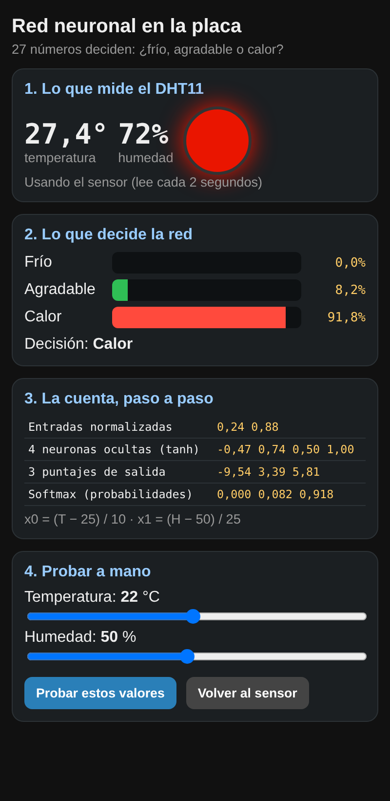

# Clase 3 – IA local: un modelo de lenguaje en la netbook y una red neuronal en la placa

Dos encuentros de 90 minutos. En el primero, un modelo de lenguaje (DeepSeek o Qwen) corre en la netbook **sin internet**. En el segundo, los alumnos entrenan una red neuronal de **27 números** y la ponen a funcionar dentro del ESP8266 con el DHT11: el LED RGB mezcla los colores según lo que "piensa" la red.

## Contenido

| Archivo | Para qué sirve |
| --- | --- |
| [`firmware/c3_red_neuronal/`](firmware/c3_red_neuronal/c3_red_neuronal.ino) | Programa de la placa: lee el DHT11, calcula la red y muestra la cuenta en la página. Va junto con [`pesos_red.h`](firmware/c3_red_neuronal/pesos_red.h) y [`pagina_web.h`](firmware/c3_red_neuronal/pagina_web.h) |
| [`guia/guia-docente.md`](guia/guia-docente.md) | Guía para el docente: requisitos de las netbooks (AVX2), KoboldCpp y LM Studio, mediciones, entrenamiento, tres niveles, problemas frecuentes y ficha del alumno |
| [`simuladores/index.html`](simuladores/index.html) | Calculadora de memoria de un modelo, próxima palabra y temperatura, **entrenador de la red que genera `pesos_red.h`** y esquema de conexionado |

El programa compila sin errores ni advertencias para **NodeMCU 1.0 (ESP-12E Module)** con el núcleo esp8266 3.1.2 y la biblioteca *DHT sensor library* 1.4.7 de Adafruit. La cuenta en C da los mismos resultados que el entrenador en JavaScript.

**Simuladores en línea:** https://dihubar-educations.github.io/robotica-iot/clases/03-ia-local-red-neuronal/simuladores/

## Datos rápidos

- **Conexionado:** DHT11 DATA → D2, VCC → 3V3, GND → GND. LED RGB: D5 (R), D6 (G), D7 (B), común → GND.
- **Red WiFi de la placa:** `IA-XXXX`, clave `robotica2026`, página en `192.168.4.1`.
- **Red neuronal:** 2 entradas (temperatura, humedad) → 4 neuronas ocultas (tanh) → 3 salidas (frío, agradable, calor) con softmax. 27 parámetros.
- **IA local en la netbook:** KoboldCpp (`koboldcpp-nocuda.exe` o `koboldcpp-oldpc.exe`) o LM Studio si el procesador tiene AVX2. Modelos: Qwen3-0.6B y DeepSeek-R1-Distill-Qwen-1.5B en Q4_K_M.

## Uso de memoria (compilado con esp8266 3.1.2)

| Memoria | Usado | Disponible |
| --- | --- | --- |
| Flash | 283 KB (26 %) | 1024 KB |
| RAM | 29 KB (36 %) | 80 KB |
| IRAM | 61,4 KB (93 %) | 64 KB |
